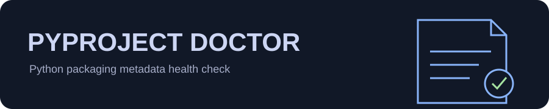

<div align="center"><h1>PyProject Doctor</h1><p>Find packaging metadata mistakes before publishing a Python project.</p></div>

## Checks
- Build-system backend and requirements.
- Project name, version, description and Python requirement.
- README path existence.
- Dependency declarations and console script target syntax.
- JSON output for CI pipelines.

## Run
```bash
python app.py
python app.py ./project/pyproject.toml --json
```
Python 3.11+ (uses built-in `tomllib`), standard library only. It reads metadata without building or installing the project.

## Tests
```bash
python -m unittest discover -s tests -v
```
MIT License.